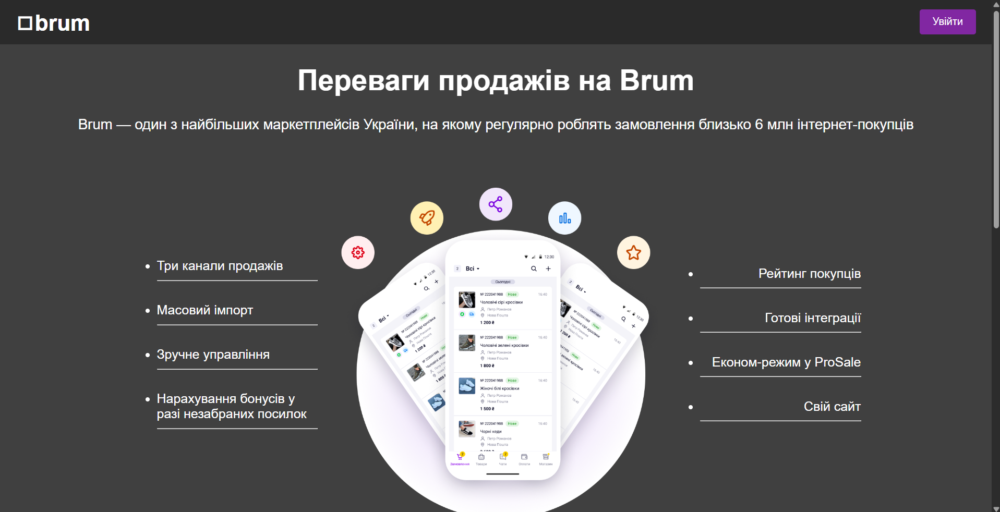
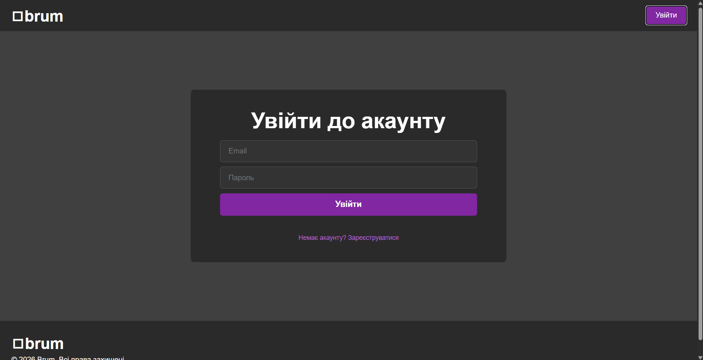
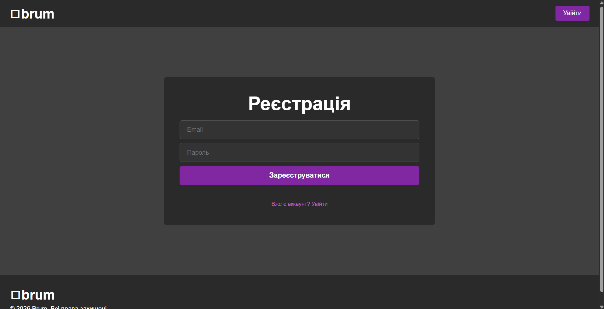
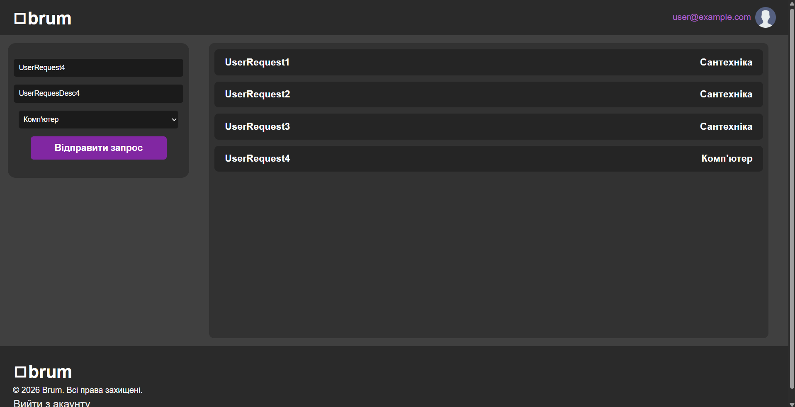
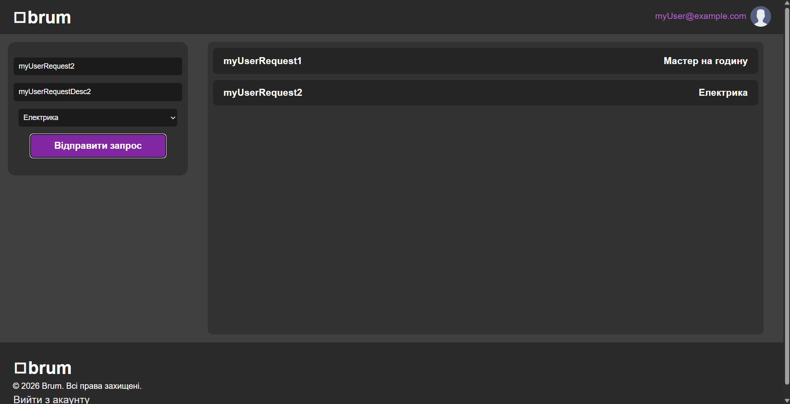
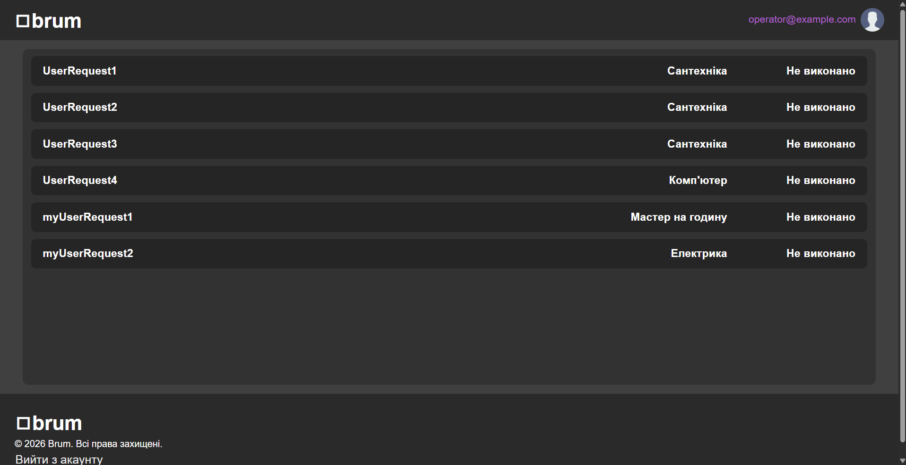
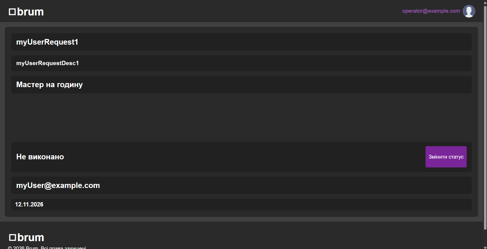

<h2>Brum — один з найбільших маркетплейсів України, на якому регулярно роблять замовлення близько 6 млн інтернет-покупців</h2>

Проєкт натхненний українським маркетплейсом Prom

</img>
</img>
</img>
</img>
</img>
</img>
</img>

<h1>Що було виконано у проєкті</h1>

<h2>Робота із заявками</h2>

Користувач повинен мати можливість створити заявку через окрему сторінку з формою ✔️

Заявка повинна містити ідентифікатор ✔️, тему ✔️, опис ✔️, категорію ✔️, пріоритет ✖️(я вважаю що у цьому проєкті це не було потрібно), дату створення ✔️, поточний статус ✔️ і контактні дані ✔️(зроблено через пошту користувача)

Користувач повинен мати можливість переглянути список своїх заявок ✔️

Користувач повинен мати можливість відкрити картку окремої заявки ✔️

---------------------------------------------------------------------------

Оператор повинен мати можливість отримати список усіх заявок ✔️

Оператор повинен мати можливість відкрити картку будь-якої заявки ✔️

Оператор повинен мати можливість додати коментар до заявки ✖️(на парі ви казали що це не обов'язково)

Необхідно реалізувати відображення помилок форми ✔️

Необхідно реалізувати стан відправлення форми ✔️

Після успішного створення заявки додаток має програмно перенаправляти користувача на сторінку картки створеної заявки ✔️

<h2>Маршрутизація та навігація</h2>

У додатку необхідно використовувати React Router ✔️

У додатку мають бути реалізовані маршрути ✔️

 /login, ✔️

 /requests, ✔️

 /requests/:id, ✔️

 /not-found(404 сторінка) ✔️

Усі невідомі маршрути повинні перенаправлятися на /not-found ✔️

Необхідно використовувати динамічний параметр маршруту для відкриття картки заявки ✔️

Необхідно використовувати Link або NavLink для переходів між екранами ✔️

Після успішного входу користувач із роллю user повинен перенаправлятися на список своїх заявок ✔️

Після успішного входу користувач із роллю operator має перенаправлятися на загальний список заявок ✔️

<h2>За що відповидають різні компоненти</h2>

MainComponent - Головна сторінка де описана коротка інформація о сайті для користувача

SignupComponent - Сторінка входу для акаунту, спочатку зареєстровані тільки user@example.com / user123 та user@example.com / user123

RegistrationComponent - Сторінка для реєстрації нового акаунту, реєструвати нового оператора не можна

UserRequestsComponent - Сторінка з основним функціоналом для простого користувача, в самому компоненті зроблена форма для додавання заявки

RequestDetailComponent - Сторінка з детальною інформацією для конкретну заявку користувача

AdminRequestsComponent - Сторінка з всіма заявками всіх користувачів

AdminRequestDetailComponent - Сторінка з детальною інформацією про конкретну заявку, її автора та можливостью змінити статус заявки

RequestsListComponent - Список заявок 

RequestElement - Елемент списку

ErrorComponent - Сторінка на випадок якщо користувач введе невірну адресу

<h3>Цей проєкт це пародія на відомий український маркетплейс Prom.ua так як він більш всього на мою думку підходив під завдання</h3>

<h3>У проєкті не були викоростані useReducer та useRedux так як на мою думку вони були не потрібні</h3>

<h2>Чи використовувався ШІ у проєкті?</h2>

Більша частина коду придумана і написана мною, з ШІ я куски коду не брав але звертався за допомогою якщо була помилка або я не міг зрозуміти як реалізувати якісь функції

Якщо є підозра на те що проєкт написаний ШІ я готовий захистити його
